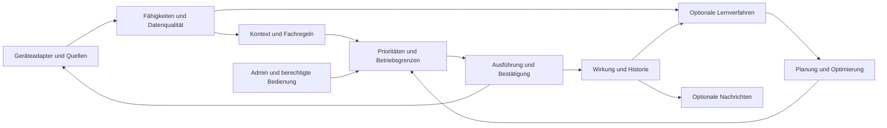

# Architektur für Adaptive Home

## Datenfluss

Geräteadapter oder freigegebene Konnektoren liefern Beobachtungen. Herstellerprofile und generische Zuordnungen normalisieren sie in Fähigkeiten. Ein Kontextdienst stellt optionale abgeleitete Eingaben bereit. Fachregeln und Optimierer schlagen typisierte Absichten vor. Ein gemeinsamer Arbiter prüft Zuständigkeit, Handbedienung, Grenzen und Konflikte. Ausschließlich der Executor übersetzt die angenommene Absicht in einen Gerätebefehl und bewertet dessen Rückmeldung.



## Verzeichnisentwurf im neuen Repository

```text
src/main.ts
src/runtime/             Instanzen, Lebenszyklus, Zuständigkeiten
src/model/               Fähigkeiten, Geräte, Räume, Anlagen
src/config/              Schema, Revisionen, Migration, Export
src/integrations/        Herstellerprofile, Kontext- und Nachrichtenadapter
src/policies/            Licht, Klima, Luft, allgemeine Betriebsmittel
src/execution/           Arbiter, Fristen, Journal und Bestätigung
src/learning/            Merkmale, Modelle, Optimierer und Bewertung
src/diagnostics/         Erklärungen und bereinigte Betriebsberichte
admin/                   ioBroker-Konfiguration und gemeinsamer Admin-Tab
test/                    Verträge, Controller-Integration und Browserprüfungen
examples/                Generische nachweislich lauffähige Konfigurationen
docs/implementation/     Dieses öffentliche Planungspaket und Manifest
docs/verification/       Bereinigte Ergebnisse
.local/                  Ignorierte private Betriebsdaten und Rohbelege
```

Der ausführende Chat darf diesen Entwurf begründet an die gewählten ioBroker-Werkzeuge anpassen. Funktionale Trennungen und öffentliche Verträge bleiben verbindlich. Keine zweite Web-Anwendung als Voraussetzung für normale Konfiguration.

## Herstellererweiterung

Ein Integrationsmodul beschreibt Erkennung, Geräteidentität, Anbindungsvarianten, unterstützte Fähigkeiten, Einheiten, Wertebereiche, Lesen/Abonnieren, Schreiben/Bestätigen, Onlinequalität und Grenzen. Es erhält nur die erforderlichen ausgewählten Datenpunkte. Eine Registrierung über ein versioniertes Manifest oder eine explizite vertrauenswürdige Paketliste ergänzt das System ohne Änderungen an Fachregeln.

Die Schnittstelle unterscheidet Fähigkeiten wie switch, dimmer, color, temperatureSensor, thermostatSetpoint, windowContact, motion, illuminance, power, energy, fan und airQuality. Weitere Fähigkeiten sind erweiterbar. Ein schaltbares Relais beweist weder Pumpenfunktion noch vorhandenen Durchfluss. Diese Bedeutung wird bei der Einrichtung festgelegt.

Generische Datenpunkt-Zuordnung ist ein gleichwertiger Erweiterungsweg für andere ioBroker-Adapter. Sie prüft Typ, Einheit, Wertebereich, Schreibbarkeit, Rückmeldeweg und Qualität. Eine fehlende native Ablauf- oder Wochenplanfunktion wird nicht erfunden. Eine eingeschränkte Funktion darf lesend verfügbar sein.

## Funktionsinstanzen und Fehlergrenzen

Eine Funktionsinstanz enthält ausgewählte Geräte und Quellen, Regeln, Betriebsgrenzen, Bedienvorrang, Nachrichtenregeln und Lernmodus. Sie kann einen Raum oder eine frei benannte Anlage steuern. Der Nutzer kann unabhängige Instanzen desselben Typs anlegen. Darstellungsgruppen erzwingen keine gemeinsame Laufzeit oder Fehlersperre.

Eine logische Entscheidungsrunde erhält einen konsistenten Snapshot mit Konfigurationsrevision. Die Ausführung prüft unmittelbar vor dem Schreiben nochmals die tatsächlichen kritischen Bedingungen. Ein unverändert bestätigtes Profil wird nicht bei jeder Abfrage erneut übertragen. Nachrichten- oder KI-Ausfall sperrt keine Geräteausführung.

## Konfiguration und Priorität

Aktive Konfiguration und letzte gültige Version liegen im definierten ioBroker-Speicher. Der lokale Cache ist eine nachweisbare Wiederanlaufhilfe, keine konkurrierende Wahrheit. Datenmodell- und Konfigurationsrevisionen ermöglichen Updates und Rücknahme. Alltagsänderungen werden als geprüfte Transaktion übernommen; technische Adapterzugänge bleiben gesondert.

Der Arbiter behandelt konfigurierte technische Schutzbedingungen, ausdrücklich zugesicherte Mindestfunktionen und menschliche Eingriffe mit dokumentierter Priorität. Normale Wochenpläne, Kontextanpassungen und Optimierungen dürfen diese Zusagen nicht stillschweigend überschreiben. Widersprüchliche harte Regeln werden bei Einrichtung oder Aktivierung abgelehnt und erklärt.

## Abhängigkeiten

Keine Abfrage der Node-RED-Flowliste als dauerhafte Voraussetzung des normalen Betriebs. Bei Migration bestehender Schreiber ihre Abschaltung und Zuständigkeit gezielt verifizieren; danach gilt der neue deklarierte Ausführungspfad. Kein paralleler Regelbetrieb am selben Aktor. Herstelleradapter und Geräte können unabhängig eigene technische Voraussetzungen haben; eine lokale Regelung macht ein Cloudgerät nicht nachträglich offlinefähig.
